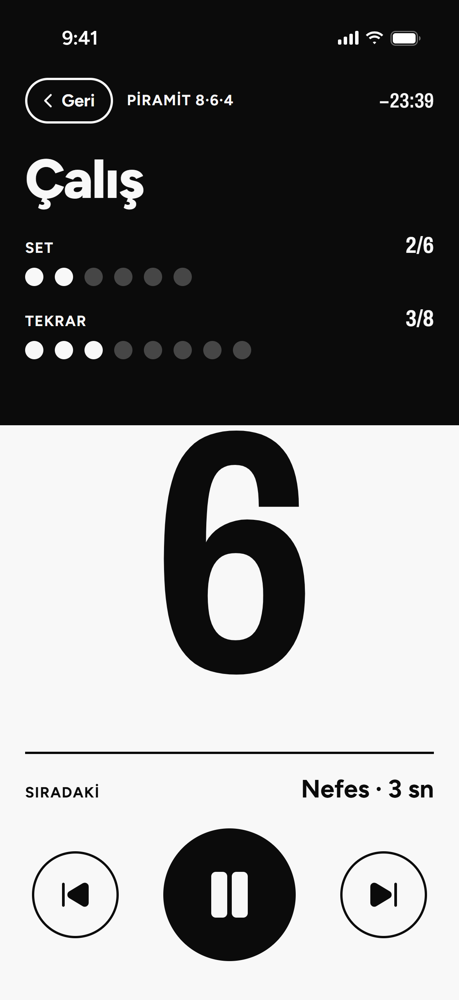
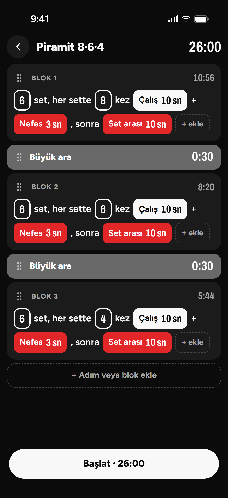
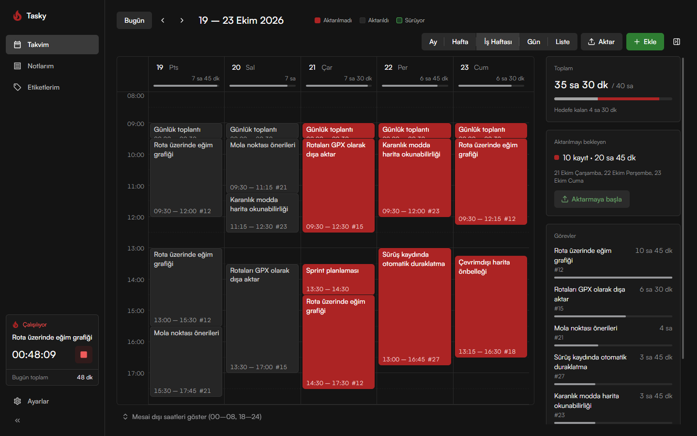
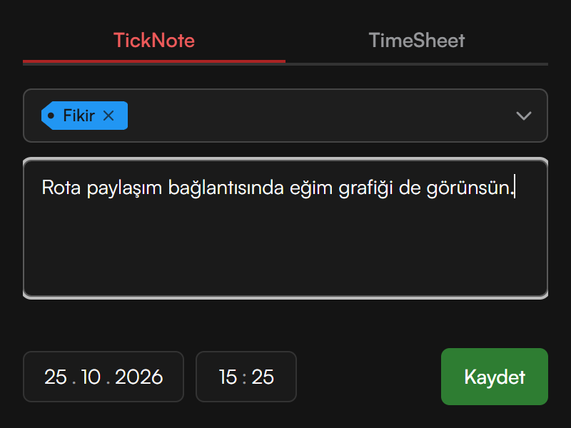
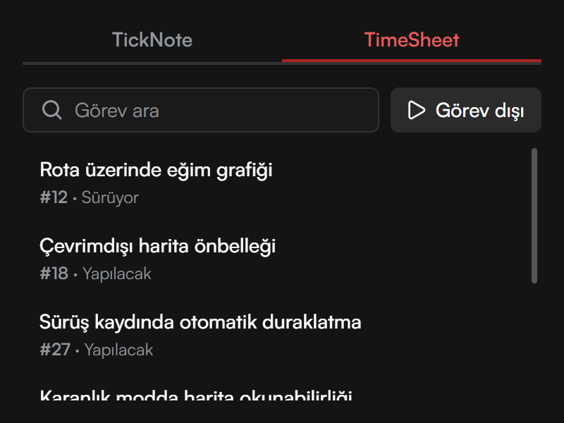
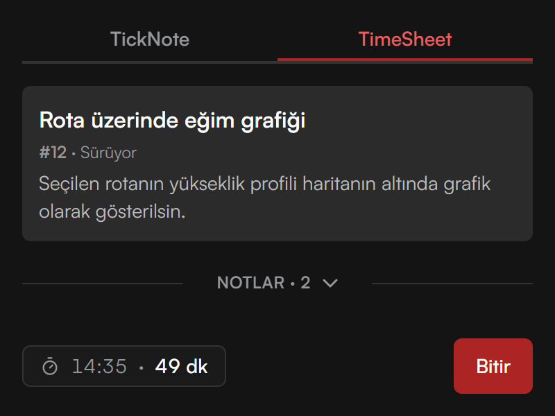

# M. Akif Kaya

## Kronset

Kronset, HIIT, Tabata ve koşu aralıkları gibi süreli antrenmanlar için yazdığım bir aralık sayacı. Her antrenman çalışma, dinlenme ve iç içe kurulabilen tekrar adımlarından oluşur. Başlatıldığında süreleri uygulama tutar ve adım değiştikçe sesle uyarır; antrenman boyunca telefona bakmak gerekmez. Türkçe ve İngilizce dahil 11 dilde kullanılabilir; hesap, reklam ve takip içermez.

[kronset.com](https://kronset.com)

<!-- Uygulama App Store'da görününce aç: [App Store'da indir](https://apps.apple.com/app/id6824268800) -->
<!-- Uygulama Google Play'de görününce aç: [Google Play'den indir](https://play.google.com/store/apps/details?id=com.kronset.app) -->

  
  
  
  

React 19 · TypeScript · Tailwind CSS 4 · Capacitor 8 · Swift

## Tasky

Tasky, gün içinde not almak ve hangi işe ne kadar zaman harcandığını kaydetmek için yazılan bir masaüstü uygulaması. Sistem tepsisinde çalışır; simgeye tıklayınca açılan küçük pencereden not yazılır ya da bir görev başlatılıp bitirilir. Çalışılan süreler haftalık takvimde kayıt olarak görünür ve orada düzenlenir. Bir çalışma sürerken tepsi simgesi alev gibi yanar, her saat dolduğunda da bildirim gelir; böylece bitirilmesi unutulan bir çalışma gözden kaçmaz.

  

  
  
  

Görevler bir iş takip aracı gibi başka bir sistemden gelir; takvimdeki süreler de aynı ya da başka bir sisteme aktarılır. Bu bağlantılar uygulamaya gömülü değildir; her sistem için tek bir JavaScript dosyası (bağlayıcı) yazılıp bir klasöre konur. Hesap gerektiren sistemlerde kullanıcı sağlayıcının kendi sayfasında giriş yapar; şifre uygulamaya uğramaz, oturum ve gizli ayarlar bilgisayarda şifrelenerek saklanır.

Electron 44 · React 19 · TypeScript · Tailwind CSS 4 · HeroUI · NeDB
