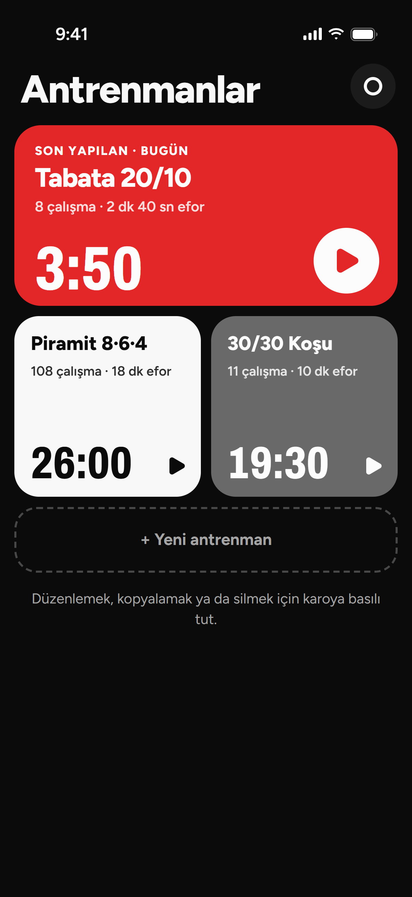
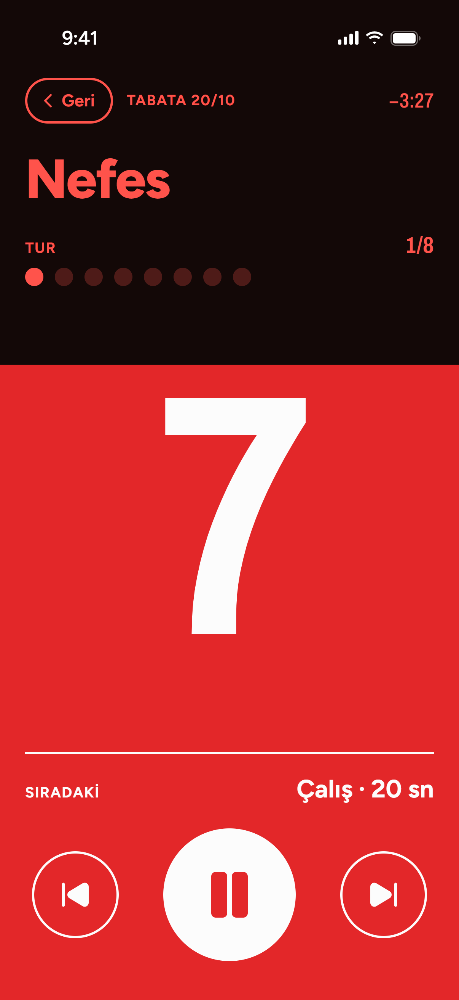

# M. Akif Kaya

## Kronio

**Antrenmanını kur, başlat, gerisini Kronio saysın.**

HIIT, Tabata ve koşu aralıkları için sade bir iOS aralık sayacı. İç içe tekrarlar, sessiz modda da duyulan sesler, Türkçe ve İngilizce. Hesap, reklam ve takip yok.

<!-- Uygulama App Store'da görününce aç: [App Store'da indir](https://apps.apple.com/app/idXXXXXXXXXX) -->

  
  
  
  

React 19 · TypeScript · Tailwind CSS 4 · Capacitor 8 · Swift
